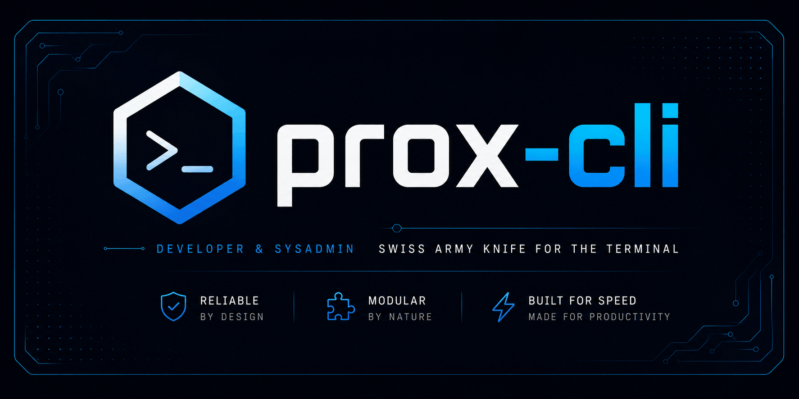

<div align="center">
<p align="center">
  
</p>



### Lightweight, modular, and extensible CLI toolkit for developers and security researchers

A modern Go-based command-line suite for everyday tasks such as encoding, password generation, hashing, port scanning, sample text generation, and AI-assisted terminal workflows.

> This project is currently in beta and is being actively shaped around a modular architecture that makes it easy to extend.

<br>

<p>

[Overview](#-overview) •
[Features](#-features) •
[Installation](#-installation) •
[Usage](#-usage) •
[Commands](#-available-commands)

</p>

<br>

[](https://go.dev)
[](LICENSE)
[]()

<br><br>

**⚡ Fast** • **🧩 Modular** • **🔐 Utility-focused** • **🛠 Developer-friendly**

</div>

---

> [!NOTE]
>
> prox-cli is designed as a lightweight and extensible toolkit. Its current focus is on practical CLI utilities that are easy to extend as the project grows.

# 🚀 Overview

<div align="center">


</div>

prox-cli is a modular command-line application written in Go. It combines a set of useful utilities into a single, easy-to-use tool for developers, pentesters, and researchers who want quick access to common operations directly from the terminal.

The project is built around a simple command registry, making it straightforward to add new functionality without rewriting the CLI structure. This modular design is one of the core strengths of the project, and new commands can be introduced by adding a small command file under the commands directory.

# ✨ Features

- 🎨 **Minimal Agent TUI**: Focused Bubble Tea interface with responsive text wrapping, status animation, command output, and explicit approval controls.
- 🤖 **Interactive Agent Mode**: AI terminal copilot available through `prox agent` and `prox ai agent`.
- 🧠 **Bounded Conversation Memory**: The agent keeps recent user, assistant, and command messages within a 6,000-character context budget.
- 🛡️ **Risk Review Layer**: Proposed commands are analyzed separately for destructive behavior, privilege escalation, data loss, and credential exposure before approval.
- 🗂️ **Manageable Agent Sessions**: Name, list, resume, export, delete, or clear locally saved conversations.
- ⏱️ **Configurable AI Requests**: Select a Gemini model, set a bounded request timeout, and cancel active agent operations.
- 🔐 Base64 encoding and decoding with optional file input/output support
- 🧪 Secure random key generation with customizable character sets
- 🧮 Hash generation for MD5, SHA1, SHA256, and SHA512
- 🌐 Port scanning for a target host and a custom port range
- 📝 Lorem Ipsum text generation for testing and placeholders
- 🧩 **Extensible command architecture**: Commands are registered through a shared interface and registry.
- 🛠 Clean and minimal Go-based implementation

# 📁 Project Structure

```text
prox-cli/
├── commands/     # Command implementations
├── core/         # Shared CLI parser and helpers
├── main.go       # CLI entry point
├── go.mod        # Go module definition
├── LICENSE       # Apache 2.0 License
├── NOTICE        # Third-party software copyrights and legal notices
└── README.md     # Project documentation
```

# 📦 Installation

prox-cli requires Go 1.26 or newer.

You can also download prebuilt binaries from the Releases section of the repository when available.

## 1. Clone the repository

```bash
git clone https://github.com/msalihberk/prox-cli.git
cd prox-cli
```

## 2. Build the binary

```bash
go build -o prox .
```

## 3. Setup Prox

```bash
./prox setup
```

## 4. Run the CLI

```bash
prox help
```

You can also run it directly without building:

```bash
go run . help
```

# 💻 Usage

> [!NOTE]
> If you haven't entered a valid API key in the setup command before, use the `prox setup setup-env` command to add your API key as an environment variable for using ai features.

## Agent mode

Start the interactive terminal agent:

```bash
prox agent
# or
prox ai agent
```

The agent remembers recent conversation turns within a 6,000-character request context. Conversations are saved locally so they can be resumed; use the session commands below to review, export, or delete them. When the agent proposes a shell command, a separate risk review analyzes the command before the confirmation screen. Commands are never executed without explicit `Y` confirmation.

During command review, use `E` to edit the proposal (the edited command is risk-checked again), `C` to copy it, `Y` to run it, or `N` to cancel. Press `Esc` during an AI request or command execution to cancel the current operation. In the prompt, `Ctrl+J` inserts a newline and `Ctrl+P` / `Ctrl+N` navigate the current session's prompt history.

### AI configuration and privacy

```bash
# Check AI configuration without revealing the API key
prox ai status

# Configure the Gemini model and request timeout (5-120 seconds)
prox ai config model gemini-flash-lite-latest
prox ai config timeout 45
prox ai config key set
prox ai config key remove

# The same modules are also registered as standalone commands
prox ai-config status
prox ai-sessions list

# Manage saved agent conversations
prox ai sessions list
prox ai sessions resume <session-id>
prox ai sessions rename <session-id> "Release investigation"
prox ai sessions export <session-id> session.json
prox ai sessions delete <session-id>
prox ai sessions clear
```

AI requests use `PROX_API_KEY` from the environment. `prox ai config key set` reuses the setup wizard; `key remove` asks for confirmation and removes the Prox-managed setting. The key is not written to the Prox JSON config, but the environment-based setup stores it in the selected shell profile on Unix or the current user's environment on Windows; it is not an encrypted credential vault. The Unix shell profile is restricted to owner-only permissions. The parent shell may retain an already inherited key until it is unset or restarted. Agent session history is stored locally in `~/.prox_agent_history.json` (in the current user's home directory); exported conversations may contain sensitive prompts and outputs, so keep export files private. Deleting a session removes it from the local history file; `sessions clear` asks for confirmation before removing all saved sessions. AI features send the explicitly requested prompt and conversation context to the configured provider. Project files and Git context are not collected automatically.

`ai explain` accepts text, a file, standard input (up to 1 MiB), or a deliberately limited project summary:

```bash
prox ai explain "connection refused"
prox ai explain --file app.log
type app.log | prox ai explain
prox ai explain "summarize the project structure" --project
```

`--project` is opt-in and interactive only. It previews Git status, unstaged diff statistics, `README.md`, and `go.mod` (bounded to 4 KiB per Git summary and 12 KiB per file); likely credential patterns are redacted before preview. Review the complete preview and confirm before it is sent. Redaction is best-effort, so do not approve content you do not want to share. Source files, staged diff contents, and other project files are not included.

AI command output is newline-terminated for convenient piping. `ai find` suggests matching built-in commands with a reason and example; verify suggestions against `prox help` before use.

Here are a few common examples using the current command set:

```bash
# Base64 encode
prox b64 encode "hello"

# Base64 decode
prox b64 decode SGVsbG8=

# Generate a secure random key
prox keygen 16

# Generate a hash from a string
prox hash -s test

# Generate a hash from a file
prox hash -f sample.txt -b

# Scan open ports on a target
prox portscan example.com -p 80,443 -w 50 -t 1000

# Generate lorem ipsum text
prox lorem -w 12 -p 2

# Use AI helpers (requires PROX_API_KEY)
prox ai cmd "list files in the current directory"

# Start the interactive agent (requires PROX_API_KEY)
prox agent

```

# 🧰 Available Commands

| Command | Description |
| :--- | :--- |
| `help` | Display the available commands |
| `b64` | Encode or decode strings to and from Base64 |
| `keygen` | Generate random secure keys |
| `hash` | Compute the hash of a given input string or file securely |
| `myip` | Display public IP information |
| `portscan` | Scan a target host for open ports concurrently |
| `lorem` | Generate dummy Lorem Ipsum text for testing and placeholders |
| `ai` | Generate terminal commands, discover relevant modules, or explain logs and payloads |
| `agent` | Start the interactive AI agent with bounded context and command risk review |
| `setup` | Make it easier to access Prox, save your API key, and enable autocomplete |
| `version` | Show the current version of the CLI |

# 🧩 Adding Your Own Module

Create a Go file under `commands/`, implement the shared `core.Commander` interface, and register the command with `core.Register`. Use the parser from [core/getargs.go](core/getargs.go) for positional arguments and flags.

```go
package commands

import (
	"prox-cli/core"
)

type ExampleCommand struct{}

func (c ExampleCommand) Execute(args []string) error {
	return nil
}

func (c ExampleCommand) Description() string {
	return "Example command"
}
func (c ExampleCommand) Help() string {
	return "Usage: prox example"
}
func (c ExampleCommand) SubCommands() []string {
	return []string{"help"}
}
func init() {
	core.Register("example", ExampleCommand{})
}
```

# 📝 License

This project is licensed under the Apache License 2.0.

See [LICENSE](LICENSE) for more details.

Third-party notices are available in [NOTICE.md](NOTICE.md).
